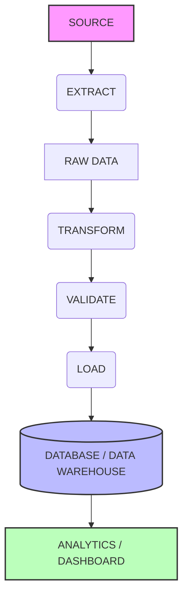

# Day 6: ETL vs ELT Architecture

## Pipeline Architecture Diagram

## ETL (Extract, Transform, Load)
ETL is a traditional data integration process where data is first extracted from various sources, transformed into a clean and analysis-ready format on a separate processing server, and finally loaded into the target data warehouse.

## ELT (Extract, Load, Transform)
ELT is a modern approach where data is extracted and loaded immediately into the target data warehouse in its raw form. The transformation happens inside the data warehouse itself, leveraging its massive computing power.

## Differences
- **Where Transformation Happens:** In ETL, it happens in a middle-tier processing engine before reaching the warehouse. In ELT, it happens inside the data warehouse.
- **Time to Load:** ELT is generally faster to load because you don't wait for transformation.
- **Data Availability:** ELT keeps all raw data in the warehouse (a Data Lakehouse approach), whereas ETL usually only stores the transformed data.

## Advantages & Disadvantages

### ETL
- **Advantages:** Better for strict compliance (transforming out PII before loading), highly structured, less storage cost in the warehouse.
- **Disadvantages:** Slower pipeline development, requires separate processing infrastructure, rigid to changes.

### ELT
- **Advantages:** Faster ingestion, flexible (raw data is always available to be re-transformed), leverages cloud warehouse scalability.
- **Disadvantages:** Higher storage and compute costs in the warehouse, potentially less secure if raw PII data is loaded into the warehouse without governance.

## Real-world Examples
- **ETL:** An on-premise SQL Server SSIS pipeline moving data from an ERP to a structured star-schema data mart.
- **ELT:** Using Fivetran to extract Salesforce data directly into Snowflake, then using dbt (data build tool) to transform the raw data into analytics tables.

## When to use ETL
- When dealing with legacy systems or on-premise databases.
- When strict data masking (PII/PHI) is required *before* data hits the warehouse.
- When compute in the target database is too expensive or limited.

## When to use ELT
- When using modern cloud data warehouses (Snowflake, BigQuery, Redshift).
- When you want to ingest massive amounts of unstructured or semi-structured data quickly.
- When you want your data analysts/engineers to use SQL for transformations (via tools like dbt).
